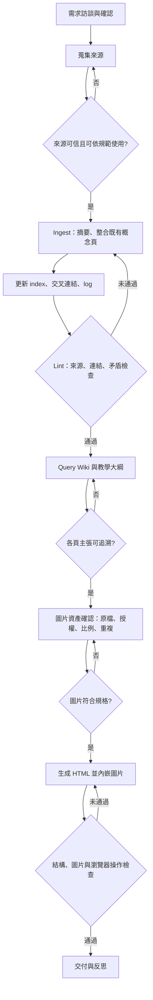

# Workflow / Graph｜Dog Signals 101（修訂版）

## 檢查往前移的理由
- S03 出現 AI 再利用限制，因此來源檢查提前至 Ingest 之前，不納入有效來源數。
- 圖片曾有搜尋預覽與實際圖片不同、裁切、缺圖、重複等問題，因此新增「圖片原檔確認」節點，在 HTML 生成前檢查。
- Wiki 內容有問題回到 Ingest；教學主張來源不足回到 Query；圖片有問題先確認原檔；HTML 顯示有問題才回到版面調整。
- 本次沒有完整的每節點失敗次數統計，反思依實際修訂事件定性判斷。
